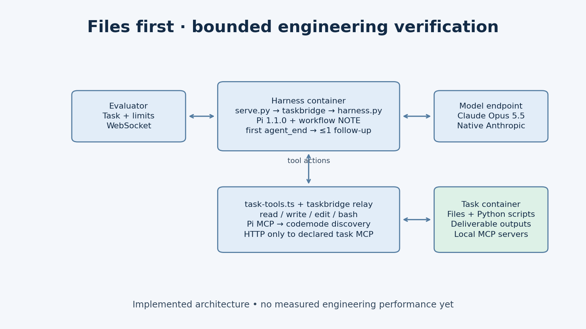
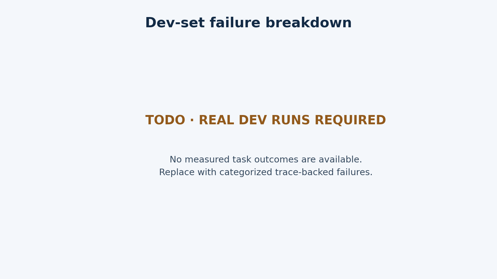
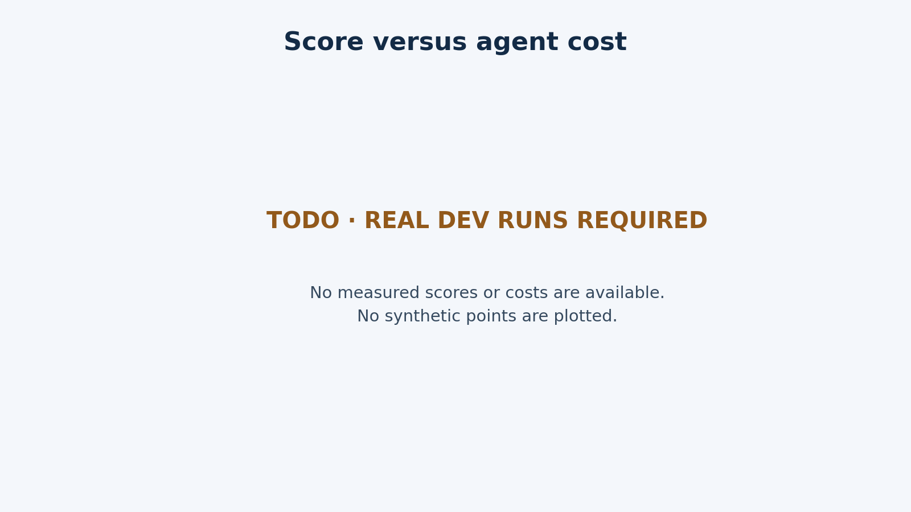

# Files first: a bounded verification layer for engineering agents

**DRAFT — not submission-ready; not yet evaluated on the dev set.**

Project Links: **TODO: public repository URL.**
Submission commit: **TODO: pin the final 40-character SHA after real evaluation.**
Target: `google-cloud/claude-opus-5-5`, using Pi 1.1.0.

Our central hypothesis is that engineering agents need to finish and check
deliverable files, not merely produce convincing explanations. We implemented
an explicit engineering workflow and one time-bounded verification turn on the
official Pi baseline. **No engineering-score improvement has been measured.**
Offline smoke and MCP checks exercise transport and tool execution, not reasoning.
The repository's inherited `artifacts/` are stale upstream outputs, not evidence
for this modified harness. Model credentials and approved dataset access are
not available in this development phase.



## 1. Insight and failure analysis — 25 points

An engineering deliverable is a machine-readable contract: exact location,
format, entities, fields, and units matter alongside the calculation. The kit's
artifact documentation warns that some graders ignore final chat text. Its
artifact check identifies the inherited `foundation-strategy` output as having
no file the grader reads. This is an artifact-validation observation, not a
new dev-task run or a diagnosis of the original agent's reasoning. Public
starter-notebook notes also motivate post-repair checks; their reported outcomes
are not our measurements.

The implemented response is to extract a deliverable checklist into scratch
space outside graded directories, produce complete drafts early, then reopen
and check outputs. This should reduce missing-file failures, but could also
waste time polishing a wrong interpretation. It is a hypothesis to test.

We did diagnose one real plumbing failure: the offline mock treated Pi's
asynchronous `searchTools()` as a synchronous array. It threw before calling an
available MCP tool. Adding `await` allowed the unchanged harness to initialize
the server, list tools, call the secret tool, and write and reread its result.
This illustrates why a mock failure is not evidence of an agent-discovery bug.

**TODO: replace the panel below with the measured 29-task failure breakdown.**
Record task IDs, rubric shortfalls, supporting trace/artifact references, and
categories such as missing output, wrong revision, units/code clause, geometry,
MCP use, and timeout. Separate grader failures from execution/infrastructure
faults. Include at least one unsuccessful intervention and its evidence.



**TODO: controlled ablation table.** Compare unchanged Pi, workflow only, and
workflow plus verification on identical task/model/judge settings and repeated
runs. Report mean score, paired task deltas, uncertainty, cost, and missing-output
rate. All values remain **TODO: real runs required**; do not use the mock as a
model or attribute inherited scores to these variants.

## 2. Engineering reasoning — 25 points

`serve.py` opens the protocol session through `taskbridge.py`. `harness.py`
creates an isolated headless Pi session, supplies the original task unchanged,
and appends the workflow. `task-tools.ts` maps read/write/edit/bash to the task
container through the local relay. Pi's native MCP integration connects to
relay-backed task endpoints and lists deferred servers in its system prompt.
Codemode discovers tools asynchronously without inserting large catalogs into
every initial model prompt. Neither the model nor the harness needs task-container
network access beyond the evaluator's declared MCP route.

The workflow requests recursive inventory, exact output requirements, the latest
governing revisions/addenda, and explicit assumptions. It requires numeric work
in Python scripts, dimensional checks, and evidence for code-clause references.
It requests early complete drafts and reopens applicable IFC/DXF/XLSX/CSV/JSON
outputs to check entities, fields and internal consistency. Bounded searching
must end in a documented assumption, with safety-critical uncertainty flagged.
These are model instructions, **not deterministic enforcement or engineering
certification**; no domain solver or CAD validator has been added to the harness.

On the first `agent_end`, `verification.mjs` can queue one follow-up to reread
the task/checklist, inspect every output, repair gaps, recheck, and summarize.
The original conversation and tools are retained. Final text supplements files.

**TODO: concrete dev-task walkthrough after authorized evaluation.** Select a
task with inspectable drawings, revisions, calculations, and exported files.
Show the actual input evidence → governing requirement → script → output →
reopened-file check chain. Compare that trajectory with a licensed engineer's
review, identifying shortcuts and unsupported code claims. Reviewer identity,
review findings, quantitative checks and task score are all **TODO**, not yet
performed. Do not invent a task narrative from the smoke fixture.

## 3. Cross-model generalizability — 15 points

The baseline supports native Anthropic for Claude, native Gemini, and an
OpenAI-compatible route for other models. The workflow and verification policy
are provider-independent; this does not establish transferable gains. Only the
configured Claude route has been exercised here with scripted mock responses.

| Variant | Model family | Tasks | Mean score | Mean cost/task |
| --- | --- | --- | --- | --- |
| Unchanged Pi | Claude | TODO | TODO | TODO |
| Workflow + verification | Claude | TODO | TODO | TODO |
| Unchanged Pi | TODO: second family | TODO | TODO | TODO |
| Workflow + verification | TODO: second family | TODO | TODO | TODO |

**TODO:** run all 29 public tasks on at least two models across families, document
exact model identifiers, versions, judge, seeds/repeats and unsuccessful runs.
Compare paired deltas and verification skip rates; identify changes that help
both families versus model-specific effects. Keep the single Stage 2 target
in `submission.yaml`; do not imply that endpoint compatibility is validation.

## 4. Efficiency and scaling — 20 points

The design retains one agent rather than a parallel planner/worker ensemble.
Thinking stays `max`; Pi's default compaction remains unchanged. Verification is
enabled by `VERIFICATION_PASSES="1"`, disabled by `"0"`, and capped at one even
for larger positive values. It runs only with at least 120 seconds before the
deadline passed by Python, which reserves 90 seconds for shutdown. An absent or
invalid deadline skips the pass. This bounds extra agent cycles, not model
calls or monetary cost; one follow-up can invoke multiple tools/model turns.
The existing overall task timeout still applies.

Large MCP catalogs remain deferred; codemode can reduce tool results before
returning them to the model. These choices aim to limit prompt overhead and
avoid late verification preventing completion. **TODO:** measure actual input,
output/cache tokens, calls, runtime, verification repairs, and total billed cost,
including judge cost reported separately. Unit and fixture checks establish
control flow only, not an efficiency advantage.



**TODO:** plot measured per-task mean score against mean agent cost across
budget/verification variants, matched tasks and repeats. Report sample sizes,
uncertainty, incomplete runs, and the pricing date. Identify a plateau and
remaining headroom only if the measurements support them. Cost estimates,
plateau location and gains are all **TODO: real runs required**.

## 5. Clarity, reproduction and submission gate — 15 points

The architecture distinguishes the sponsored model route from task-side tool
actions. The cover is `cover.png`. This draft intentionally contains placeholders
for the two evidence figures; it does **not** yet satisfy the empirical rubric.

From the kit directory, run `uv run python -m kit check ../my-harness` with a
real authorized proxy, then `uv run python eval/run.py ../my-harness` and
`uv run python -m kit artifacts ../my-harness`. See the root README for offline
mock setup. Never use the fixture for dev scoring. **TODO:** record dataset/kit
revision, model/judge configuration, run IDs and pinned harness commits;
regenerate and validate artifacts before submission.

Rebuild figures from the repository root:

```sh
uv run --with matplotlib==3.10.9 python docs/make_figures.py
uv run --with matplotlib==3.10.9 python docs/make_figures.py --results measured.csv
```

The optional CSV is an explicit normalized export, not a claim to parse native
kit logs: `config,model,task_id,repeat,score,cost_usd,failure_category`. Supply one
row per task/repeat/config/model; include failed runs with their actual score
and incurred agent cost. Use USD and document pricing/judge accounting alongside
the export. The script averages rows by config/model, labels sample sizes, and
counts sub-perfect rows by the supplied category (blank becomes `unspecified`).
Use matched task sets/repeats for comparisons. Without data it draws TODO panels,
never synthetic observations. **TODO:** replace all placeholders and obtain the
required real failure analysis, engineer review, cross-model and budget evidence
before submitting a ≤2,000-word Writeup with repository URL and final commit.
